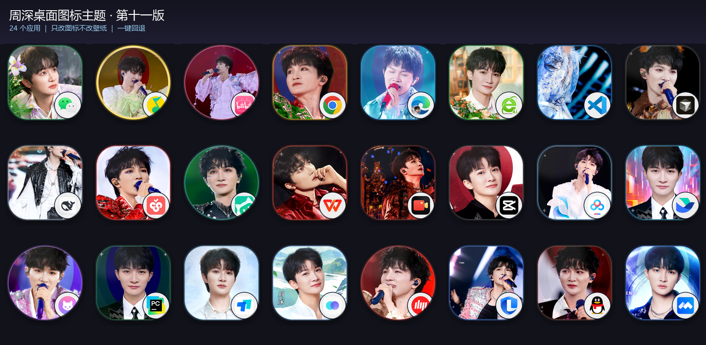
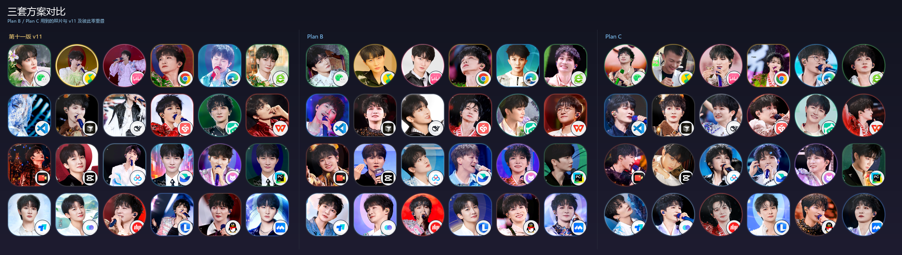
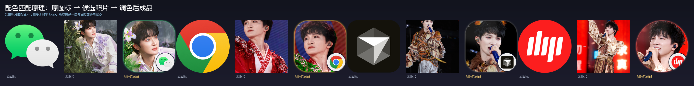
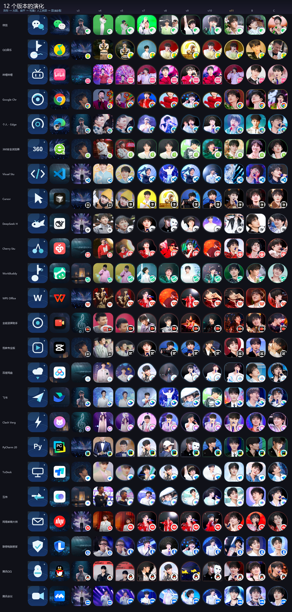

# 周深桌面图标主题 · ZS Desktop Icon Theme

**当前版本：v1**

> 24 个常用 Windows 应用，一键换成周深舞台照图标。
> 只改图标，不动壁纸 —— 不满意，一条命令回退到安装前。

<p align="center">
  
</p>

<p align="center">
  <a href="https://github.com/SeekAfterSeek/zs-desktop-icon-theme/stargazers">
    </a>
  
  
  
</p>

---

## 这是什么

一个**纯图标替换**的 Windows 桌面主题包。它把桌面上 24 个常用应用的快捷方式图标
换成经过配色匹配的周深舞台照，同时保留：

- 你的壁纸 —— 一个像素都不动
- 系统主题、任务栏、窗口颜色 —— 不动
- 应用本身 —— 不改 exe，不注入，不装驱动

每个图标右下角保留**原应用的小角标**，所以换成照片后你依然一眼认得出哪个是微信、哪个是 Steam。

> **想直接看技术亮点？** → [HIGHLIGHTS.md](HIGHLIGHTS.md)

---

## 一分钟上手

```powershell
# 1. 克隆（或点右上角 Code → Download ZIP）
git clone https://github.com/SeekAfterSeek/zs-desktop-icon-theme.git
cd zs-desktop-icon-theme

# 2. 先看看会改哪些（不修改任何东西）
powershell -ExecutionPolicy Bypass -File installer\Install-Theme.ps1 -Action list

# 3. 应用主题
powershell -ExecutionPolicy Bypass -File installer\Install-Theme.ps1 -Action apply

# 4. 不满意？一键回退
powershell -ExecutionPolicy Bypass -File installer\Install-Theme.ps1 -Action rollback
```

### 关于管理员权限

Windows 有两个桌面目录：

| 目录 | 需要提权 |
|---|---|
| `C:\Users\<你>\Desktop` | 不需要 |
| `C:\Users\Public\Desktop` | **需要管理员权限** |

很多应用（微信、QQ、Chrome 等）的快捷方式装在**公共桌面**，所以：

- **不提权运行** → 个人桌面的图标会换，公共桌面的会提示 `[×] 无权限`，其余照常工作
- **提权运行** → 全部 24 个都换

想要全部生效，右键 PowerShell → 以管理员身份运行，再执行 `-Action apply`。
安装器会把没权限的清单列出来，不会中途报错退出。

### 切换方案

```powershell
powershell -ExecutionPolicy Bypass -File installer\Install-Theme.ps1 -Theme planB -Action apply
powershell -ExecutionPolicy Bypass -File installer\Install-Theme.ps1 -Theme planC -Action apply
```

### 它会自动适配你的电脑

安装器**不假设你装了哪些软件**。它会扫描你的桌面（含 OneDrive 重定向、公共桌面），
按应用名匹配，你装了什么就换什么。没装的应用自动跳过。

24 个应用全部命中会显示 `命中 24 / 24`，只装了 10 个就是 `10 / 24`，不影响使用。

### 回退是怎么做的

第一次 `apply` 时，安装器会把每个快捷方式的**原始 `IconLocation`** 记到
`%LOCALAPPDATA%\ZsIconTheme\original-shortcuts.json`。
`rollback` 读取这份记录并写回，所以能精确还原到安装前的状态 —— 包括你之前用过别的图标包的情况。

回退后这个文件会被删除，不会残留。

---

## 三套方案

| 方案 | 形状 | 照片 | 说明 |
|---|---|---|---|
| **v11**（终版） | 圆角方形 / 圆形 | 精选 | 三标准加权评分后的最终版 |
| **Plan B** | 以圆角方形为主 | **全部首次使用** | 与 v11 零重叠的替代方案 |
| **Plan C** | 以圆形为主 | **全部首次使用** | 与 v11、Plan B 都零重叠 |

<p align="center">
  
</p>

---

## 设计逻辑：三条标准与权重

这个主题不是「随便找张好看的照片贴上」。每张照片和每个应用的配对，都经过三条标准的加权评分：

| 权重 | 标准 | 怎么算的 |
|---|---|---|
| **34%** | 配色与原图标相似度 | 整图色彩分布 vs 原图标真实配色，余弦相似度 |
| **34%** | 衣服颜色与图标主色和谐 | **只看衣服区域**（下巴以下、按脸宽取样），命中率加权 |
| **20%** | 颜色齐全 | 原图标每个主色（占比 ≥10%）在照片里能否凑出来 |
| 7% | 脸够大 | 按人脸像素推算可裁剪放大倍数 |
| 5% | 清晰度 | 拉普拉斯方差 |

**为什么衣服色权重这么高？** 因为这是用户的明确要求：人物照里衣服占了画面主体，
背景再好看，衣服颜色不对整体就不和谐。

**为什么只用余弦相似度不够？** 因为扁平 logo 和真实照片的颜色分布永远不可能相等。
所以额外做了一层**调色**：把照片的色相、饱和度、明暗向原图标靠拢，同时**保护人脸和头发不被染色**。

<p align="center">
  
</p>

---

## 迭代过程：11 个版本

这个项目真正有意思的部分不是最终图，而是**它是怎么一步步收敛的**。

| 版本 | 思路 | 结果 |
|---|---|---|
| v1 | 深蓝扁平化 glyph 图标 | ❌ 太素，没有个人风格 |
| v2 | 舞台照作底 + 原图标轮廓 | ❌ 轮廓压住脸 |
| v3 | 周深写真满铺，右下角原应用角标 | ✅ 方向对了（QQ音乐联名款的思路） |
| v4 | 每个 APP 配一张配色匹配的照片 | ⚠️ 配色靠猜 |
| v5 | 异形图标（拱形/鹅卵石/波浪）+ 提亮 | ⚠️ 用户反馈有暗沉遮罩 |
| v7 | 按**背景色**匹配 | ⚠️ 背景好看，但和图标不搭 |
| v8 | 按**衣服色**匹配 | ✅ 明显更和谐 |
| v9 | 图标色 × 衣服色 | ⚠️ 过度约束 |
| v10 | 衣服色为准 + 小脸裁剪放大 | ✅ 接近可用 |
| **v11** | 三标准加权 + 调色 + 唯一性约束 + 人脸检测 | ✅ **终版** |
| Plan B/C | 换掉全部照片，验证方法可迁移 | ✅ 方法有效 |

完整对比（12 版 × 24 应用，每格 210px）：

<p align="center">
  
</p>

逐页大图见 [`docs/ITERATIONS.md`](docs/ITERATIONS.md)。

---

## 踩过的坑

这个项目最硬的部分不在设计，而在**几件反直觉的 Windows 系统行为**。
每一条都是实测撞出来的，完整记录见 [`docs/PITFALLS.md`](docs/PITFALLS.md)。

| # | 坑 | 现象 | 解法 |
|---|---|---|---|
| 1 | ICO 帧格式 | 桌面图标变成空白纸 | 必须用 `bitmap_format="bmp"` |
| 2 | ICO 路径含中文/空格 | 同上，空白纸 | ICO 必须放纯 ASCII 路径 |
| 3 | PowerShell 无 BOM | `Unexpected token`，中文乱码 | 脚本必须存为 UTF-8 with BOM |
| 4 | 单元素数组退化 | `$paths[0]` 取到首字母 | `List[string].ToArray()` |
| 5 | 人脸检测 | 把手肘当脸，裁剪全错 | 改用 YuNet 深度模型 |
| 6 | 图案重复 | 两个 APP 用了同一张照片的相邻帧 | pHash 汉明距离约束 |
| 7 | 素材混入他人 | 图标里出现陌生面孔 | 人工审核 + 构图筛 |

---

## 技术亮点

**1. 无 OpenCV 依赖的完整色彩管线**
自己实现的 HSV 转换、色相圆周均值、LUT 调色，纯 numpy + Pillow。

**2. 全局最优分配，而不是逐项贪心**
24 个应用一起求解。逐项贪心会让 WPS 和网易邮箱同时挑中同一张最高分照片。

**3. 三重唯一性约束**

- 照片文件不重复
- pHash 汉明距离 ≥ 10（防止同一张图的相邻帧）
- 连拍系列全局只用一次

**4. 构图质量筛**
自动识别并剔除：远景小舞台、空舞台、带文字海报、拼图、多人合影、活动背景板。

**5. 人脸感知裁剪**
按 YuNet 检测框定位，把脸稳定放在图标 42% 高度、脸高占 46%，脸小会按像素量反向放大。

**6. 安装器零硬编码**
不写死用户名、不写死盘符、不假设装了什么软件。

---

## 目录结构

```
zs-icon-theme/
├── installer/
│   └── Install-Theme.ps1        # 安装 / 回退 / 预览
├── themes/
│   ├── v11/icons/               # 24 个 png + 24 个 ico
│   ├── planB/icons/
│   └── planC/icons/
├── src/                         # 完整生成流程（可复现）
│   ├── facedet.py               # YuNet 人脸检测
│   ├── grade_lib.py             # 调色引擎
│   ├── pool_all.py              # 素材池扫描
│   ├── assign_global.py         # 全局分配
│   └── render_v11.py            # 渲染
├── docs/
│   ├── ITERATIONS.md            # 11 个版本的完整迭代记录
│   ├── PITFALLS.md              # 所有踩坑与环境适配
│   └── DESIGN.md                # 设计标准与算法细节
├── tools/
│   ├── png2ico.py               # PNG → ICO（多尺寸 BMP 帧）
│   ├── add_bom.py               # PowerShell 脚本加 BOM
│   └── verify_ico.py            # ICO 帧格式校验
└── assets/                      # 效果图
```

---

## 自行修改

想做自己的主题？完整流程在 [`docs/DESIGN.md`](docs/DESIGN.md)。

最省事的做法：直接替换 `themes/v11/icons/` 里的 PNG（256×256，透明背景），
然后重跑 `tools/png2ico.py` 重新生成 ICO。

---

## 版权与免责

- 本仓库**不包含**任何周深的原始照片，只分发渲染后的图标成品。
- 照片素材来自公开渠道，仅用于个人桌面美化，不作商业用途。
- 图标中的第三方应用标志（微信、Chrome、QQ 等）版权归各自公司所有。
- 这是一个**同人性质的个人项目**，与周深本人及其工作室无关。

如需下架，请开 issue。

---

## License

代码部分 MIT。图标成品仅供个人使用。
