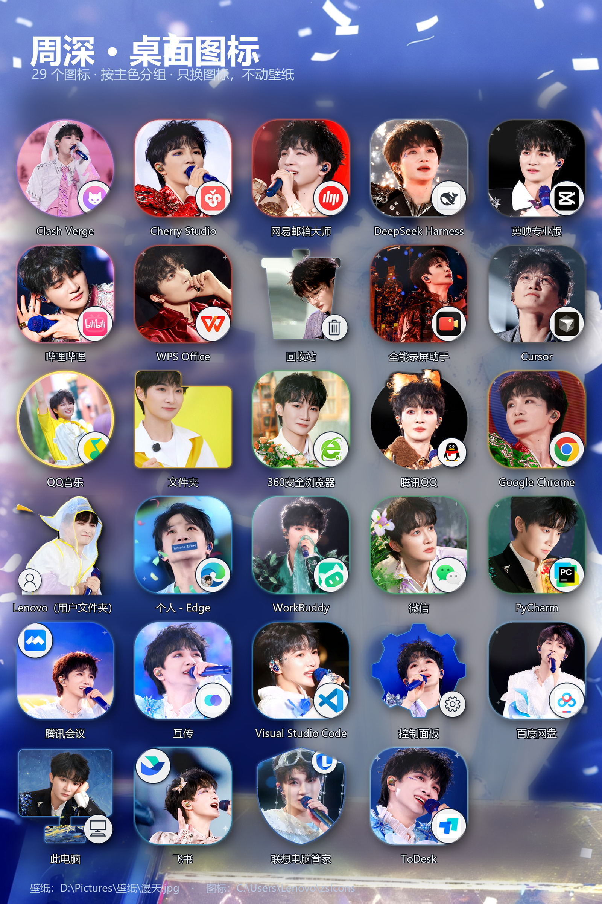
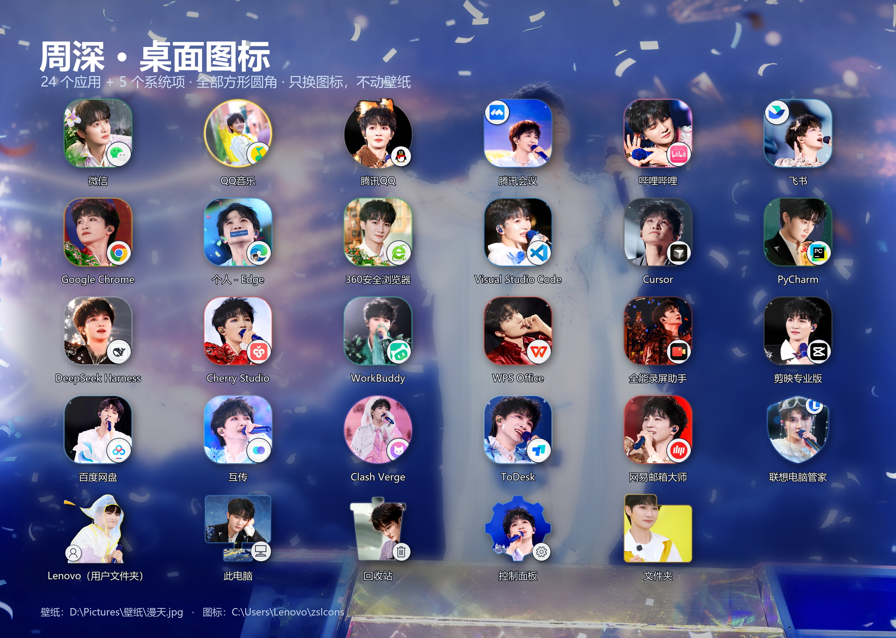

# 周深桌面图标主题 · ZS Desktop Icon Theme

**当前版本：v13**

> 24 个常用 Windows 应用 + 5 个系统项，一键换成周深舞台照图标。
> 只改图标，不动壁纸 —— 不满意，一条命令回退到安装前。

<p align="center">
  <br>
  <sub>29 个图标（24 应用 + 5 系统项）· 按主色分组 · 只换图标，不动壁纸</sub>
</p>

<p align="center">
  
</p>

<p align="center">
  <a href="https://github.com/SeekAfterSeek/zs-desktop-icon-theme/stargazers">
    </a>
  
  
  
</p>

---

## 这是什么

一个**纯图标替换**的 Windows 桌面主题包。它把桌面上 24 个常用应用的快捷方式图标
换成经过配色匹配的周深舞台照，同时保留：

- 你的壁纸 —— 一个像素都不动
- 系统主题、任务栏、窗口颜色 —— 不动
- 应用本身 —— 不改 exe，不注入，不装驱动

每个图标右下角保留**原应用的小角标**，所以换成照片后你依然一眼认得出哪个是微信、哪个是 Steam。

> **想直接看技术亮点？** → [HIGHLIGHTS.md](HIGHLIGHTS.md)

---

## 安装

### 系统要求

- Windows 10 / 11（64 位）
- PowerShell 5.1 及以上（系统自带，不用另装）
- 不需要装 Python、不需要管理员权限（除非你的快捷方式在公共桌面）

### 方式一：下载 ZIP（不熟悉命令行的用这个）

1. 页面右上角 **Code → Download ZIP**
2. 解压到**纯英文、无空格**的路径，例如 `D:\zs-icon-theme`

   > 这一点是必须的：ICO 放在含中文或空格的路径下，桌面会把它渲染成一张白纸。
   > 踩坑记录见 [docs/PITFALLS.md](docs/PITFALLS.md) 第 2 条。脚本自己也会把图标
   > 复制到 `%LOCALAPPDATA%\ZsIconTheme\icons`（纯 ASCII）再引用，但你解压的路径仍建议保持干净。

3. 在解压出来的文件夹里，地址栏输入 `powershell` 回车，然后执行：

```powershell
powershell -ExecutionPolicy Bypass -File installer\Install-Theme.ps1 -Action apply
```

或者右键 `installer\Install-Theme.ps1` → **使用 PowerShell 运行**。
如果提示「禁止运行脚本」，就是上面那条带 `-ExecutionPolicy Bypass` 的命令。

### 方式二：git clone

```powershell
git clone https://github.com/SeekAfterSeek/zs-desktop-icon-theme.git
cd zs-desktop-icon-theme
powershell -ExecutionPolicy Bypass -File installer\Install-Theme.ps1 -Action apply
```

### 装完没变化？

Windows 会缓存 `.lnk` 的图标。脚本已经做了 `SHChangeNotify` 通知，多数情况立刻就变。
如果还是旧图，按顺序试：

1. 桌面按 `F5`
2. 运行仓库里的 `src\versions\v13\force_refresh_icons.py`（会清 iconcache 并重启 explorer）
3. 注销再登录

## 使用

### 四个动作

| 命令参数 | 作用 | 会改系统吗 |
|---|---|---|
| `-Action list` | 列出本机检测到的应用、命中几个 / 共几个 | 不会 |
| `-Action preview` | 告诉你「将会改哪些快捷方式」 | 不会 |
| `-Action apply` | 应用主题（默认最新 **v13**） | 会改桌面快捷方式的图标 |
| `-Action rollback` | 还原到安装前的图标 | 会改回去 |

```powershell
# 先看一眼
powershell -ExecutionPolicy Bypass -File installer\Install-Theme.ps1 -Action list

# 应用最新版
powershell -ExecutionPolicy Bypass -File installer\Install-Theme.ps1 -Action apply

# 换指定版本
powershell -ExecutionPolicy Bypass -File installer\Install-Theme.ps1 -Theme v12 -Action apply

# 一键还原
powershell -ExecutionPolicy Bypass -File installer\Install-Theme.ps1 -Action rollback
```

可选主题：`v13`（默认）、`v12`、`v11`、`planB`、`planC`。

### 脚本到底做了什么

1. 把 `themes\<版本>\icons\*.ico` 复制到 `%LOCALAPPDATA%\ZsIconTheme\icons\`（纯 ASCII 路径）
2. 改写桌面 `.lnk` 快捷方式的 **IconLocation** 指向这些 ICO
3. 首次运行前，把每个快捷方式**原来的** IconLocation 记到
   `%LOCALAPPDATA%\ZsIconTheme\original-shortcuts.json`
4. 用 `SHChangeNotify` 通知外壳刷新（**不重启 explorer**，不打断你手上的事）

**它不会**：改壁纸、改系统主题、改任务栏、改窗口颜色、改任何 exe、注入进程、装驱动、写开机项。

### 只想换其中几个图标？

不改脚本也行，直接改快捷方式属性：右键 `.lnk` → 属性 → 更改图标 → 选
`themes\v13\icons\<应用名>.ico`。这个改动同样可以用 `-Action rollback` 撤销
（前提是那次 `apply` 记录过它的原值）。

### 关于系统项

主题里另外还有 5 个系统项图标（用户文件夹、此电脑、回收站、控制面板、文件夹），
它们不是 `.lnk`，改的是注册表 `CLSID\...\DefaultIcon` 或文件夹的 `desktop.ini`，
**安装脚本目前不处理这 5 项**，需要手动：

| 项 | 改法 |
|---|---|
| 此电脑 / 回收站 / 控制面板 / 用户文件夹 | `HKCU\Software\Microsoft\Windows\CurrentVersion\Explorer\CLSID\{CLSID}\DefaultIcon` 的默认值 |
| 普通文件夹 | 文件夹里放 `desktop.ini`，写 `IconResource=<ico 路径>,0` |

改动前记得先导出对应注册表键备份。这部分我会在后续版本做成 `-IncludeSystemItems` 开关。

### 关于管理员权限

Windows 有两个桌面目录：

| 目录 | 需要提权 |
|---|---|
| `C:\Users\<你>\Desktop` | 不需要 |
| `C:\Users\Public\Desktop` | **需要管理员权限** |

很多应用（微信、QQ、Chrome 等）的快捷方式装在**公共桌面**，所以：

- **不提权运行** → 个人桌面的图标会换，公共桌面的会提示 `[×] 无权限`，其余照常工作
- **提权运行** → 全部 24 个都换

想要全部生效，右键 PowerShell → 以管理员身份运行，再执行 `-Action apply`。
安装器会把没权限的清单列出来，不会中途报错退出。

### 切换方案

```powershell
powershell -ExecutionPolicy Bypass -File installer\Install-Theme.ps1 -Theme planB -Action apply
powershell -ExecutionPolicy Bypass -File installer\Install-Theme.ps1 -Theme planC -Action apply
```

### 它会自动适配你的电脑

安装器**不假设你装了哪些软件**。它会扫描你的桌面（含 OneDrive 重定向、公共桌面），
按应用名匹配，你装了什么就换什么。没装的应用自动跳过。

24 个应用全部命中会显示 `命中 24 / 24`，只装了 10 个就是 `10 / 24`，不影响使用。

### 回退是怎么做的

第一次 `apply` 时，安装器会把每个快捷方式的**原始 `IconLocation`** 记到
`%LOCALAPPDATA%\ZsIconTheme\original-shortcuts.json`。
`rollback` 读取这份记录并写回，所以能精确还原到安装前的状态 —— 包括你之前用过别的图标包的情况。

回退后这个文件会被删除，不会残留。

---

## 三套方案 + 完整迭代档案

| 方案 | 形状 | 照片 | 说明 |
|---|---|---|---|
| **v13**（当前默认） | 圆角方形为主 | 最终定稿 | 含 5 个系统项（用户文件夹/此电脑/回收站/控制面板/文件夹）；Lenovo 改雨衣大头照 + 阴影立体 |
| **v12** | 圆角方形为主 | 混搭 B/C + 手工精选 | 联想/腾讯会议等重选表情更生动的照片 |
| **v11** | 圆角方形 / 圆形 | 精选 | 三标准加权评分后的版本 |
| **Plan B** | 以圆角方形为主 | **全部首次使用** | 与 v11 零重叠的替代方案 |
| **Plan C** | 以圆形为主 | **全部首次使用** | 与 v11、Plan B 都零重叠 |

<p align="center">
  
</p>

### 全部 11 个历史版本都保留在仓库里

从最开始的深蓝扁平 glyph，到最后的混搭版，每一版的 24 张成品图和生成脚本都在：

```
themes/versions/
├── v1/   深蓝扁平 glyph（无照片）
├── v2/   舞台照 + 原图标轮廓
├── v3/   写真满铺 + 右下角角标   ← 结构定型
├── v4/   每个 APP 配配色匹配的照片
├── v5/   异形图标 + 提亮
├── v7/   按背景色自动匹配
├── v8/   改为按衣服色匹配        ← 配色逻辑转向
├── v9/   图标色 × 衣服色双约束
├── v10/  衣服色为准 + 小脸裁剪放大
├── v11/  三标准加权 + 调色 + 唯一性  ← 方法定型
├── v12/  混搭 Plan B/C + 全部方形
└── v13/  系统项 + 定稿（当前版本，29 个图标）
```

每一版都有独立的提交记录和说明文档 `docs/versions/vN.md`，
可以用 `git log --oneline` 看完整脉络。

---

## 设计逻辑：三条标准与权重

这个主题不是「随便找张好看的照片贴上」。每张照片和每个应用的配对，都经过三条标准的加权评分：

| 权重 | 标准 | 怎么算的 |
|---|---|---|
| **34%** | 配色与原图标相似度 | 整图色彩分布 vs 原图标真实配色，余弦相似度 |
| **34%** | 衣服颜色与图标主色和谐 | **只看衣服区域**（下巴以下、按脸宽取样），命中率加权 |
| **20%** | 颜色齐全 | 原图标每个主色（占比 ≥10%）在照片里能否凑出来 |
| 7% | 脸够大 | 按人脸像素推算可裁剪放大倍数 |
| 5% | 清晰度 | 拉普拉斯方差 |

**为什么衣服色权重这么高？** 因为这是用户的明确要求：人物照里衣服占了画面主体，
背景再好看，衣服颜色不对整体就不和谐。

**为什么只用余弦相似度不够？** 因为扁平 logo 和真实照片的颜色分布永远不可能相等。
所以额外做了一层**调色**：把照片的色相、饱和度、明暗向原图标靠拢，同时**保护人脸和头发不被染色**。

<p align="center">
  
</p>

---

## 迭代过程：11 个版本

这个项目真正有意思的部分不是最终图，而是**它是怎么一步步收敛的**。

| 版本 | 思路 | 结果 |
|---|---|---|
| v1 | 深蓝扁平化 glyph 图标 | ❌ 太素，没有个人风格 |
| v2 | 舞台照作底 + 原图标轮廓 | ❌ 轮廓压住脸 |
| v3 | 周深写真满铺，右下角原应用角标 | ✅ 方向对了（QQ音乐联名款的思路） |
| v4 | 每个 APP 配一张配色匹配的照片 | ⚠️ 配色靠猜 |
| v5 | 异形图标（拱形/鹅卵石/波浪）+ 提亮 | ⚠️ 用户反馈有暗沉遮罩 |
| v7 | 按**背景色**匹配 | ⚠️ 背景好看，但和图标不搭 |
| v8 | 按**衣服色**匹配 | ✅ 明显更和谐 |
| v9 | 图标色 × 衣服色 | ⚠️ 过度约束 |
| v10 | 衣服色为准 + 小脸裁剪放大 | ✅ 接近可用 |
| **v11** | 三标准加权 + 调色 + 唯一性约束 + 人脸检测 | ✅ **终版** |
| Plan B/C | 换掉全部照片，验证方法可迁移 | ✅ 方法有效 |

完整对比（12 版 × 24 应用，每格 210px）：

<p align="center">
  
</p>

逐页大图见 [`docs/ITERATIONS.md`](docs/ITERATIONS.md)。

---

## 踩过的坑

这个项目最硬的部分不在设计，而在**几件反直觉的 Windows 系统行为**。
每一条都是实测撞出来的，完整记录见 [`docs/PITFALLS.md`](docs/PITFALLS.md)。

| # | 坑 | 现象 | 解法 |
|---|---|---|---|
| 1 | ICO 帧格式 | 桌面图标变成空白纸 | 必须用 `bitmap_format="bmp"` |
| 2 | ICO 路径含中文/空格 | 同上，空白纸 | ICO 必须放纯 ASCII 路径 |
| 3 | PowerShell 无 BOM | `Unexpected token`，中文乱码 | 脚本必须存为 UTF-8 with BOM |
| 4 | 单元素数组退化 | `$paths[0]` 取到首字母 | `List[string].ToArray()` |
| 5 | 人脸检测 | 把手肘当脸，裁剪全错 | 改用 YuNet 深度模型 |
| 6 | 图案重复 | 两个 APP 用了同一张照片的相邻帧 | pHash 汉明距离约束 |
| 7 | 素材混入他人 | 图标里出现陌生面孔 | 人工审核 + 构图筛 |

---

## 技术亮点

**1. 无 OpenCV 依赖的完整色彩管线**
自己实现的 HSV 转换、色相圆周均值、LUT 调色，纯 numpy + Pillow。

**2. 全局最优分配，而不是逐项贪心**
24 个应用一起求解。逐项贪心会让 WPS 和网易邮箱同时挑中同一张最高分照片。

**3. 三重唯一性约束**

- 照片文件不重复
- pHash 汉明距离 ≥ 10（防止同一张图的相邻帧）
- 连拍系列全局只用一次

**4. 构图质量筛**
自动识别并剔除：远景小舞台、空舞台、带文字海报、拼图、多人合影、活动背景板。

**5. 人脸感知裁剪**
按 YuNet 检测框定位，把脸稳定放在图标 42% 高度、脸高占 46%，脸小会按像素量反向放大。

**6. 安装器零硬编码**
不写死用户名、不写死盘符、不假设装了什么软件。

---

## 目录结构

```
zs-icon-theme/
├── installer/
│   └── Install-Theme.ps1        # 安装 / 回退 / 预览
├── themes/
│   ├── v11/icons/               # 24 个 png + 24 个 ico
│   ├── planB/icons/
│   └── planC/icons/
├── src/                         # 完整生成流程（可复现）
│   ├── facedet.py               # YuNet 人脸检测
│   ├── grade_lib.py             # 调色引擎
│   ├── pool_all.py              # 素材池扫描
│   ├── assign_global.py         # 全局分配
│   └── render_v11.py            # 渲染
├── docs/
│   ├── ITERATIONS.md            # 11 个版本的完整迭代记录
│   ├── PITFALLS.md              # 所有踩坑与环境适配
│   └── DESIGN.md                # 设计标准与算法细节
├── tools/
│   ├── png2ico.py               # PNG → ICO（多尺寸 BMP 帧）
│   ├── add_bom.py               # PowerShell 脚本加 BOM
│   └── verify_ico.py            # ICO 帧格式校验
└── assets/                      # 效果图
```

---

## 自行修改

想做自己的主题？完整流程在 [`docs/DESIGN.md`](docs/DESIGN.md)。

最省事的做法：直接替换 `themes/v11/icons/` 里的 PNG（256×256，透明背景），
然后重跑 `tools/png2ico.py` 重新生成 ICO。

---

## 授权协议

**开源，但禁止商用。**

| 部分 | 许可 |
|---|---|
| 代码（`installer/`、`tools/`、`src/`） | MIT —— 随便用、随便改，保留版权声明即可 |
| 图标成品、展示图、仓库内所有图像 | **CC BY-NC 4.0** —— 可转载、可修改、可自用，**不得用于任何商业用途** |

「商业用途」包括但不限于：售卖图标包、收费主题、放进付费装机盘、用于商家广告/宣传物料、
印在商品上、作为付费课程/教程的素材。

同时请遵守以下三条：

1. **本项目是非官方同人项目**，与周深本人、其工作室、以及腾讯、字节、阿里等应用厂商**均无关系**；
2. 图标里的第三方应用标志（微信、QQ、Chrome、哔哩哔哩……）版权归各自公司，这里只是做视觉搭配；
3. 人像照片的版权属于**原摄影者与发布账号**（见下一节），本项目只做裁剪、调色、加角标，
   **不主张**对照片本身的任何权利。

**如权利人认为有不妥，开一个 issue，我会立刻下架相关图像。**

---

## 图片来源

本仓库**不分发任何原始照片**，只分发渲染后的图标成品。所有素材抓取自公开账号，
抓取时间：**2026 年 5 月 — 11 月**。

### 主要来源账号

| 平台 | 账号 | 地址 | 本主题采用 |
|---|---|---|---|
| 微博 | **周深工作室** | <https://weibo.com/u/7478855230>（UID `7478855230`） | 5 个图标 |
| 微博 | **ForCharlie丨周深图文站** | <https://weibo.com/u/6987697229>（UID `6987697229`） | 11 个图标 |
| 小红书 | **ForCharlie｜周深图文站** | <https://www.xiaohongshu.com/user/profile/5fc1f667000000000101d007> | 6 个图标 |
| 小红书 | 周深粉丝后援小分队 | 小红书站内搜索该账号名 | 其中 1 个（全能录屏助手） |
| 小红书 | 工作室账号（`studio_xhs_src`） | 小红书站内搜索「周深工作室」 | 其中 1 个（百度网盘） |
| 微博 | 早期整理（`c929b_*`，2023 年前的历史图集） | 见文件名，具体单条未记录 | 1 个（腾讯会议） |

### 逐个图标的出处

| 图标 | 采用的照片 | 来源账号 |
|---|---|---|
| 微信 | `studio_20261025_76889_5` | 周深工作室（微博） |
| QQ音乐 | `station_20260510_59173_0` | ForCharlie丨周深图文站（微博） |
| 哔哩哔哩 | `station_20260524_50364_0` | ForCharlie丨周深图文站（微博） |
| Google Chrome | `station_20260822_99475_1` | ForCharlie丨周深图文站（微博） |
| 个人 - Edge | `fc_0979` | ForCharlie｜周深图文站（小红书） |
| 360 安全浏览器 | `studio_20260903_94616_0` | 周深工作室（微博） |
| Visual Studio Code | `fc_1277` | ForCharlie｜周深图文站（小红书） |
| Cursor | `station_0030` | ForCharlie丨周深图文站（微博） |
| DeepSeek Harness | `station_20260912_43162_3` | ForCharlie丨周深图文站（微博） |
| Cherry Studio | `studio_20260926_93785_7` | 周深工作室（微博） |
| WorkBuddy | `station_0007` | ForCharlie丨周深图文站（微博） |
| WPS Office | `studio_20261004_85716_6` | 周深工作室（微博） |
| 全能录屏助手 | `nw_0047` | 周深粉丝后援小分队（小红书） |
| 剪映专业版 | `fc_0475` | ForCharlie｜周深图文站（小红书） |
| 百度网盘 | `sx_0505` | 工作室账号（小红书） |
| 飞书 | `station_20260628_79992_0` | ForCharlie丨周深图文站（微博） |
| Clash Verge | `f2_0169` | ForCharlie（小红书，补充抓取） |
| PyCharm | `studio_20261026_32066_5` | 周深工作室（微博） |
| ToDesk | `station_20260927_91932_0` | ForCharlie丨周深图文站（微博） |
| 互传 | `station_20260925_18697_3` | ForCharlie丨周深图文站（微博） |
| 网易邮箱大师 | `station_20260530_05624_8` | ForCharlie丨周深图文站（微博） |
| 联想电脑管家 | `fc_0995` | ForCharlie｜周深图文站（小红书） |
| 腾讯 QQ | `station_20261017_31971_5` | ForCharlie丨周深图文站（微博） |
| 腾讯会议 | `c929b_90b313ea59` | 微博早期图集 |
| Lenovo 用户文件夹 | `f2_0015`（透明雨衣） | ForCharlie（小红书，补充抓取） |
| 此电脑 / 回收站 / 控制面板 / 文件夹 | 同上两个微博账号的光图池 | 周深工作室 / ForCharlie丨周深图文站 |

> 文件名里的 `studio_` 前缀对应周深工作室，`station_` 对应图文站，
> `fc_` / `f2_` / `nw_` / `sx_` 对应小红书，`c929b_` 是早期微博图。

---

## License

- 代码：**MIT**
- 图标与图片：**CC BY-NC 4.0（禁止商用）**

完整说明见上面的「授权协议」。商用授权不在本仓库范围内，也不提供。
